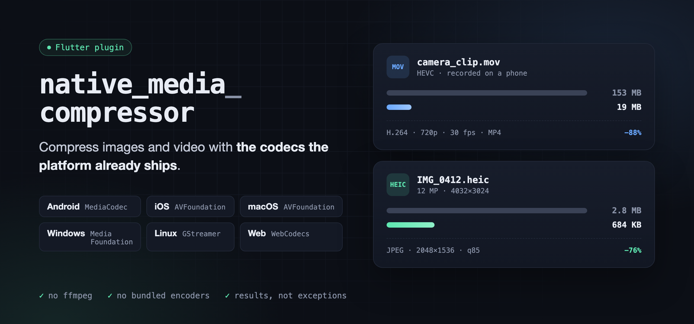

<p align="center">
  
</p>

<p align="center">
  <a href="https://pub.dev/packages/native_media_compressor"></a>
  <a href="https://github.com/StarProxima/native_media_compressor/actions/workflows/ci.yml"></a>
  <a href="LICENSE"></a>
</p>

Compress images and videos in Flutter with the codecs the platform already ships. No ffmpeg, no bundled encoders: the package adds only its own code to your app, and the encoding runs on the system's codecs, hardware-accelerated where the device has them.

- **Video** to H.264 in MP4: scale down, cap the frame rate and bitrate, stop early at a size limit, report progress, cancel.
- **Images** to JPEG or PNG: scale down, apply EXIF orientation, strip metadata. HEIC, WebP and animated inputs are read where the platform can decode them.
- **Probe** size, rotation, duration, codecs, HDR and frame count from the headers, without decoding, to decide whether compression is worth it.
- **Results instead of exceptions.** Every call ends with a status, and a failed call never touches the destination file.

## Platform support

| Platform | Video | Images | Probe |
|---|---|---|---|
| Android 5.0+ | MediaCodec | ImageDecoder, BitmapFactory | MediaExtractor, image headers |
| iOS 13+, macOS 10.15+ | AVFoundation | ImageIO | AVFoundation, ImageIO |
| Windows 10+ | Media Foundation | WIC | Media Foundation, WIC |
| Linux | GStreamer | gdk-pixbuf | GStreamer, image headers |
| Web: Chrome and Edge 94+, Safari 16.4+, Firefox 130+ | WebCodecs | `createImageBitmap`, `OffscreenCanvas` | MP4 and image headers |

What each platform needs and where it says `unsupported` is listed under [Platform notes](#platform-notes).

## Installation

```sh
flutter pub add native_media_compressor
```

The package asks for no permissions and needs no manifest changes: it reads and writes only the paths you pass, so your app needs access to them. On Linux, install the GStreamer development headers before building, see [Platform notes](#platform-notes).

## Usage

### Compress a video

```dart
import 'package:native_media_compressor/native_media_compressor.dart';

final task = NativeMediaCompressor.compressVideo(
  source: '/path/to/input.mov',
  destination: '/path/to/output.mp4',
  options: const VideoOptions(maxShortSide: 720, videoBitrate: 2500000),
);

task.progress.listen((fraction) => print('${(fraction * 100).round()}%'));

final result = await task.result;
if (result.isCompressed) {
  print('${result.width}x${result.height}, ${result.sizeBytes} bytes');
} else {
  print('kept the original: ${result.status} ${result.message ?? ''}');
}
```

`task.cancel()` stops the work; `result` then completes with `CompressionStatus.cancelled`. Videos are compressed one at a time, so a second call waits for the first.

### Compress an image

```dart
final result = await NativeMediaCompressor.compressImage(
  source: '/path/to/photo.heic',
  destination: '/path/to/photo.jpg',
  options: const ImageOptions(maxLongSide: 2048, quality: 85),
);
```

Images and probes run in parallel.

### Probe before compressing

Probing reads the headers only, so it is cheap enough to run for every picked file:

```dart
final video = await NativeMediaCompressor.probeVideo('/path/to/input.mov');
if (video != null && video.width * video.height > 1280 * 720) {
  // Worth compressing.
}

final image = await NativeMediaCompressor.probeImage('/path/to/photo.heic');
print('${image?.width}x${image?.height}, animated: ${image?.isAnimated}');
```

Both return `null` when the platform cannot read the file.

### Compress in place

`destination` may equal `source`. The output goes to a temporary file next to it and replaces the original only when compression succeeds:

```dart
await NativeMediaCompressor.compressImage(source: path, destination: path);
```

## Options

### `VideoOptions`

| Option | Default | Meaning |
|---|---|---|
| `maxShortSide` | `720` | Upper bound for the shorter side, in pixels. |
| `maxLongSide` | `null` | Upper bound for the longer side, in pixels. |
| `videoBitrate` | `2500000` | Target bitrate, in bits per second. |
| `maxFrameRate` | `30` | Frames above this rate are dropped. Capped at 240. |
| `maxBytes` | `null` | Stop with `tooLarge` as soon as the output exceeds this size. |
| `includeAudio` | `true` | Keep the audio tracks. Non-AAC audio is `unsupported` unless this is `false`. |

The frame is scaled down to fit both bounds, keeping its aspect ratio, and never scaled up.

### `ImageOptions`

| Option | Default | Meaning |
|---|---|---|
| `maxShortSide` | `null` | Upper bound for the shorter side, in pixels. |
| `maxLongSide` | `2048` | Upper bound for the longer side, in pixels. |
| `format` | `ImageFormat.jpeg` | `jpeg` or `png`. |
| `quality` | `85` | JPEG quality from 0 to 100; ignored for PNG. |

## Results instead of exceptions

Compression never throws on bad input or a missing codec. Check `CompressionResult.status`:

| Status | Meaning |
|---|---|
| `compressed` | The output is at `destination`. |
| `unsupported` | The platform cannot do it: no codec, non-AAC audio while `includeAudio` is true, a format it cannot encode. Use the original file. |
| `tooLarge` | The output passed `VideoOptions.maxBytes`; compression stopped early. |
| `cancelled` | `CompressionTask.cancel()` was called. |
| `interrupted` | The system stopped the work, for example in the background. Retrying usually works. |
| `failed` | The input is unreadable or a codec failed; `message` has details. |

Every status except `compressed` leaves `destination` as it was.

## What the output looks like

- **Video:** SDR H.264 in MP4, scaled down to fit `maxShortSide` and `maxLongSide`. The displayed orientation is kept. AAC audio is copied without re-encoding; on Windows it is re-encoded to AAC. Frames above `maxFrameRate` are dropped.
- **HDR video** (HLG, PQ, Dolby Vision, as phone cameras record by default) is tone-mapped to SDR on Android 7+ when the device decodes the source profile, on iOS 14+, macOS 11+ and in the browser. On Windows and Linux it is `unsupported` for now.
- **Images:** JPEG or PNG, scaled down to fit both bounds, with EXIF orientation applied to the pixels and no metadata copied. Animated images keep the first frame. JPEG output of an image with transparency is flattened onto white.

## Platform notes

**Android.** `source` may be a `content://` URI. HEIC decoding needs Android 9 or newer.

**iOS and macOS.** Works with both Swift Package Manager and CocoaPods. HDR conversion needs iOS 14 or macOS 11.

**Windows.** Video needs Media Foundation, which Windows N editions only have with the Media Feature Pack; without it video calls return `unsupported` and the app still starts. HEVC video, HEIC and WebP need the matching codec extensions from the Microsoft Store; without them those inputs are `unsupported`.

**Linux.** GStreamer is loaded at runtime, so the app starts and images work without it. Video needs:

- the development headers at build time: `libgstreamer1.0-dev` and `libgstreamer-plugins-base1.0-dev` on Debian and Ubuntu. Without them the plugin still builds, and video calls return `unsupported`;
- at run time, a decoder for the input and an H.264 encoder (`x264enc`, `openh264enc` or `vah264enc`), for example from `gstreamer1.0-plugins-good`, `-bad`, `-ugly` and `gstreamer1.0-libav`.

HEIC and WebP images need the matching gdk-pixbuf loaders, such as `heif-gdk-pixbuf` and `webp-pixbuf-loader`.

**Web.** `source` is a `blob:`, `data:` or same-origin (or CORS-enabled) `http(s):` URL. `destination` is ignored: `result.path` is a new object URL of the output, which you release with `URL.revokeObjectURL` when done. Video input must be MP4 or QuickTime (fragmented MP4 is `unsupported`), and which input codecs decode depends on the browser; without WebCodecs video calls return `unsupported`. HEIC images are `unsupported` outside Safari.

**Background isolates.** Compression works from any isolate, but `CompressionTask.progress` only reports in the root isolate.

## Example

The [example app](example/lib/main.dart) picks a file, probes it and compresses it with progress and cancel. Its [integration tests](example/integration_test/plugin_integration_test.dart) run on real media on every platform in CI.

## License

MIT, see [LICENSE](LICENSE).
